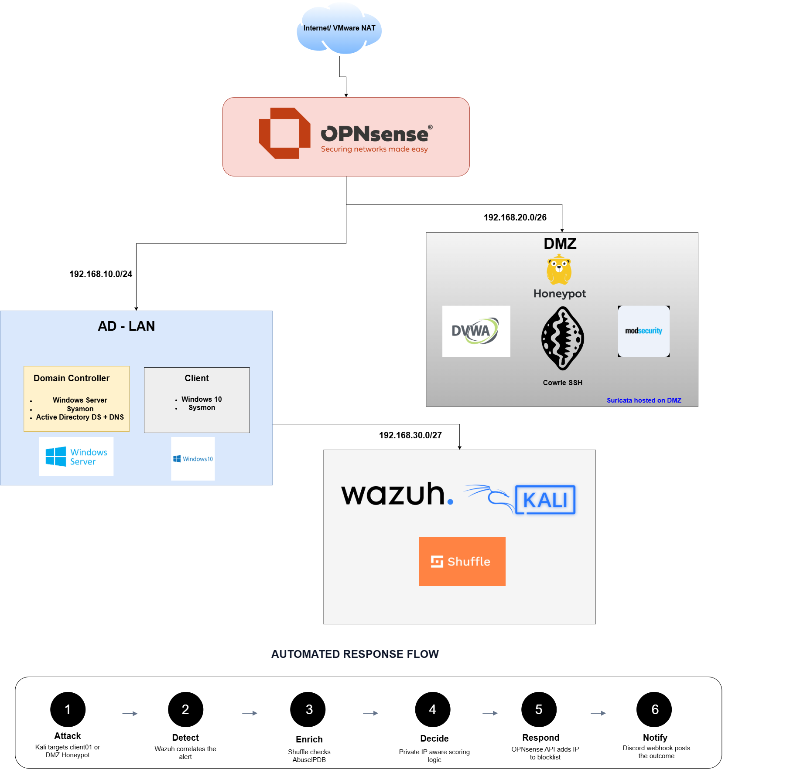
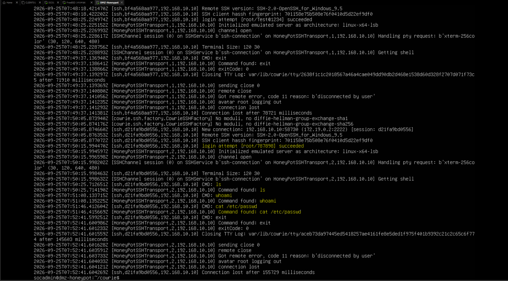
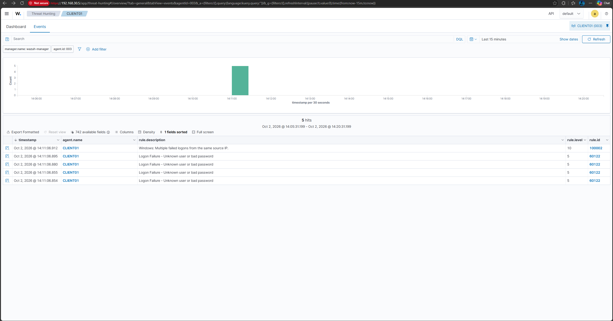
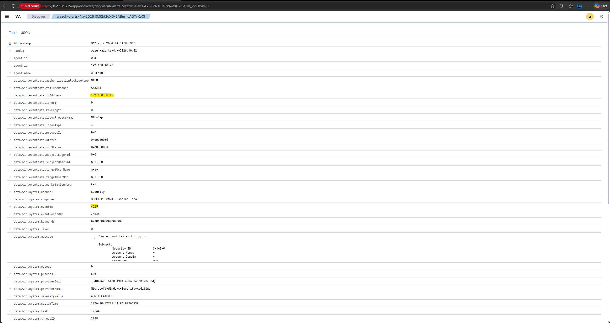
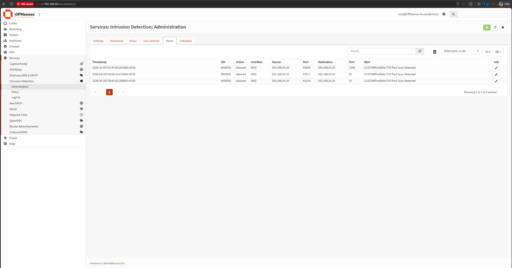
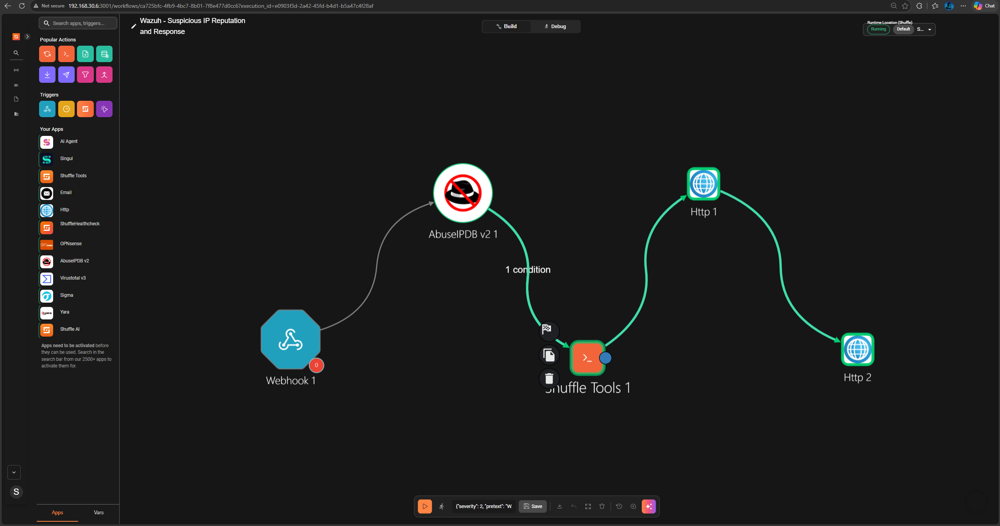
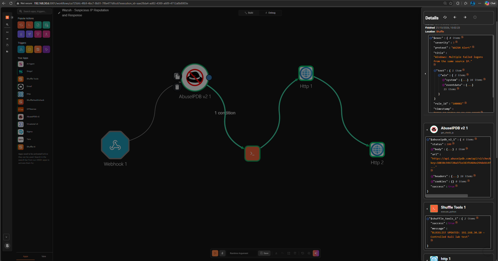
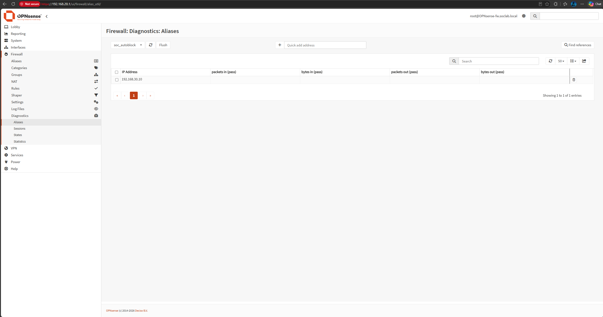

# SOC Home-lab

A self-built Security Operations Center: segmented network, Active Directory domain, deliberately exposed honeypots, a SIEM correlating logs across every zone, and a SOAR playbook that detects a live attack and blocks it automatically - no human in the loop. Built entirely on a single 16 GB Windows PC, zero licensed software, zero cloud spend.

## Overview

I built this to go past "I can install security tools" and into "I can explain why a detection fires and why the response is automated." Every component below is wired to the next: an attack generates a log, the log becomes a correlated alert, the alert gets enriched with real threat intelligence, and a scripted decision - not a human - decides whether to act.

## Architecture

One OPNsense firewall at the center, three zones, deny-by-default on all of them:

| Zone | Subnet | Purpose |
|---|---|---|
| **DMZ** | `192.168.20.0/26` | Exposed bait - DVWA behind a WAF, an SSH honeypot, a network IDS |
| **AD-LAN** | `192.168.10.0/24` | Protected assets - a real Active Directory domain |
| **SOC-LAN** | `192.168.30.0/27` | Detection and response - SIEM, SOAR, attacker box |

## Tech stack

| Layer | Tool | Role |
|---|---|---|
| Firewall / router | OPNsense | Perimeter control, interface-level rules, routing between zones |
| Domain | Windows Server + Windows 10 | Active Directory, GPO audit policy |
| Endpoint visibility | Sysmon | Process, network, and file-level logging beyond native Windows events |
| Web honeypot | DVWA + ModSecurity | Deliberately vulnerable app behind a logging WAF |
| SSH honeypot | Cowrie | Records every login attempt and command an attacker types |
| Network IDS | Suricata | Signature-based detection on the DMZ host |
| SIEM | Wazuh | Collects and correlates logs from every zone into one place |
| Attacker | Kali Linux | Generates real attack traffic against the lab |
| SOAR | Shuffle | Automates enrichment, decision, and response |
| Threat intel | AbuseIPDB | Live IP reputation feeding the automated decision |
| Notification | Discord webhook | Real-time visibility when a block fires |

## Build process

### 1. Perimeter - OPNsense

Four VMware host-only networks built to match the three zones plus WAN.

OPNsense's first internal interface is named `LAN`, not `OPT1` - interfaces mapped and renamed to match the real zone layout.

OPNsense's internal interfaces carry zero firewall rules by default - not restrictive, none. Deny-by-default rules built explicitly per zone from there.

### 2. Active Directory domain

Windows Server deployed as Domain Controller (UEFI, Secure Boot, and a virtual TPM required for Server 2025).

Audit policy enabled explicitly - logon events, account management, policy changes, privilege use - none of it logs by default.

Client joined to the domain.

Sysmon installed on both domain machines for process- and network-level visibility.

### 3. DMZ - honeypots

DVWA deployed behind Docker.

ModSecurity WAF deployed in front of it, DetectionOnly mode, tested with a SQL injection payload.

Cowrie SSH honeypot deployed on the standard SSH port (the real SSH daemon moved to a non-standard port first).

### 4. Detection layer - Wazuh + Kali

Wazuh agents enrolled on the Domain Controller, the client, and the DMZ host.

Kali Linux built as the dedicated attacker box.

### 5. Simulated attacks

**RDP brute force** - tested with Ncrack after ruling out Hydra's RDP module (flagged "experimental" by its own maintainers, with documented false-positive reports), then validated directly against a scripted FreeRDP connection after Ncrack itself failed to complete the handshake reliably.

**Malicious file / suspicious PowerShell** - EICAR test string caught by Windows Defender; a deliberately suspicious PowerShell command caught at the process level by Sysmon.

**Port scan** - Nmap against the DMZ host, detected by Suricata (relocated to the DMZ host directly after a confirmed OPNsense 26.7.3 platform bug prevented its ruleset from loading on the firewall itself).

### 6. Automated response - Shuffle SOAR

Workflow: Wazuh alert → Shuffle webhook → AbuseIPDB enrichment → scripted decision → OPNsense API block → Discord notification.

The decision step runs as a Python node rather than Shuffle's built-in visual condition feature, after the native condition failed repeated tests against confirmed-correct input. The same node explicitly treats internal lab IPs as hostile by default, since a public reputation API has no data on private addresses - every attacker in this lab is, by definition, on one.

## Key challenges and fixes

| Problem | Root cause | Fix |
|---|---|---|
| OPNsense interfaces didn't match my plan | First internal interface is named `LAN`, not `OPT1` | Remapped interfaces against the console's actual output |
| No internet access on fresh zones | OPT interfaces carry zero firewall rules by default | Explicit outbound allow rule added per zone |
| Gateway pings succeeded but nothing routed further | VMware's host-side adapter claimed the same IP as OPNsense on three separate virtual networks | Diagnosed with `tcpdump` on OPNsense's own interfaces; reassigned host adapters |
| `apt`/Docker silently failing on new Linux VMs | Ubuntu tries IPv6 first; this lab has none | IPv6 disabled at the kernel level on every Linux VM |
| Windows Firewall rule looked correctly enabled but traffic was still dropped | Rule was scoped to `LocalSubnet`, invisible unless checked specifically | Scope widened explicitly to the lab's subnets |
| Suricata ran clean but generated zero alerts on the firewall | Confirmed, currently-open OPNsense 26.7.3 bug - ruleset selections never persist | Suricata moved to the DMZ host directly, installed via Ubuntu's own packaging |
| RDP brute-force tool gave inconsistent results | Hydra's RDP module is explicitly experimental; a second tool (Ncrack) also failed the handshake | Verified against a direct FreeRDP connection; scripted FreeRDP for the actual test |
| Shuffle's visual condition feature failed repeatedly | Unreliable comparison evaluation on this build, confirmed across multiple operators and a known-correct value | Replaced with a Python node handling both the decision and the block action |

## Results

- Full attack-to-automated-response loop working end to end, three independent detection paths (host logon events, file/process behavior, network signatures) feeding one SIEM
- Automated response makes a judgment call, not a blind one - internal vs. external source IPs are handled differently, matching how the logic would need to behave in production
- Every major failure in the build traced to a verifiable root cause (a platform bug, a tool limitation, a default I hadn't accounted for) rather than left unresolved

## Future improvements

1. **Map detections to MITRE ATT&CK.** Add a small detection matrix showing the observed behaviour, evidence source, Wazuh/Suricata rule, ATT&CK technique, and limitations. Only map techniques supported by the actual test evidence.
2. **Add incident/case management.** Evaluate an open-source case-management option such as DFIR-IRIS and create cases containing the alert, source/destination, timestamps, enrichment, response action, and analyst notes.
3. **Harden automated response.** Add trusted-IP allowlists, duplicate handling, block expiry/unblock procedure, clearer API-error handling, and manual approval for higher-impact actions.
4. **Improve secret and TLS handling.** Move credentials out of visible workflow fields and replace disabled certificate validation with trusted TLS.
5. **Add useful SOC metrics.** Track alert counts, workflow failures, block outcomes, false positives, and time from detection to notification.
6. **Add AI-assisted triage carefully.** Use AI to summarise evidence and draft investigation notes, while keeping the original event data available for verification. Do not send secrets or sensitive logs to an external service, and do not allow unsupervised high-impact response actions.
7. **Add incident ticketing and case management. Integrate a case management platform such as DFIR-IRIS with Shuffle so selected Wazuh alerts can automatically create incident tickets.

---

*This project reflects my learning process: building, testing, troubleshooting, checking the evidence, and being clear about what is complete versus what still needs work.*

